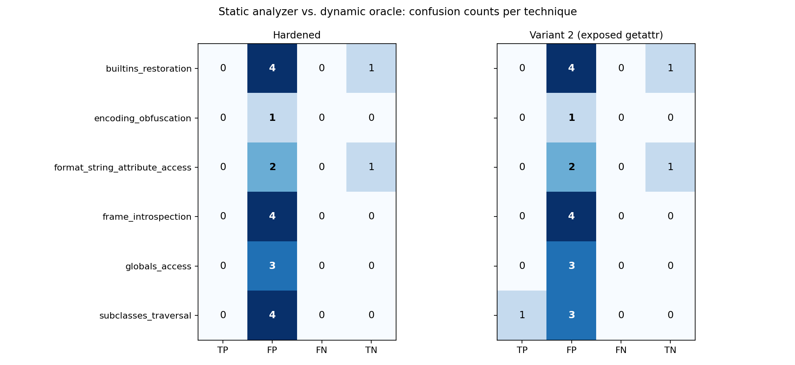
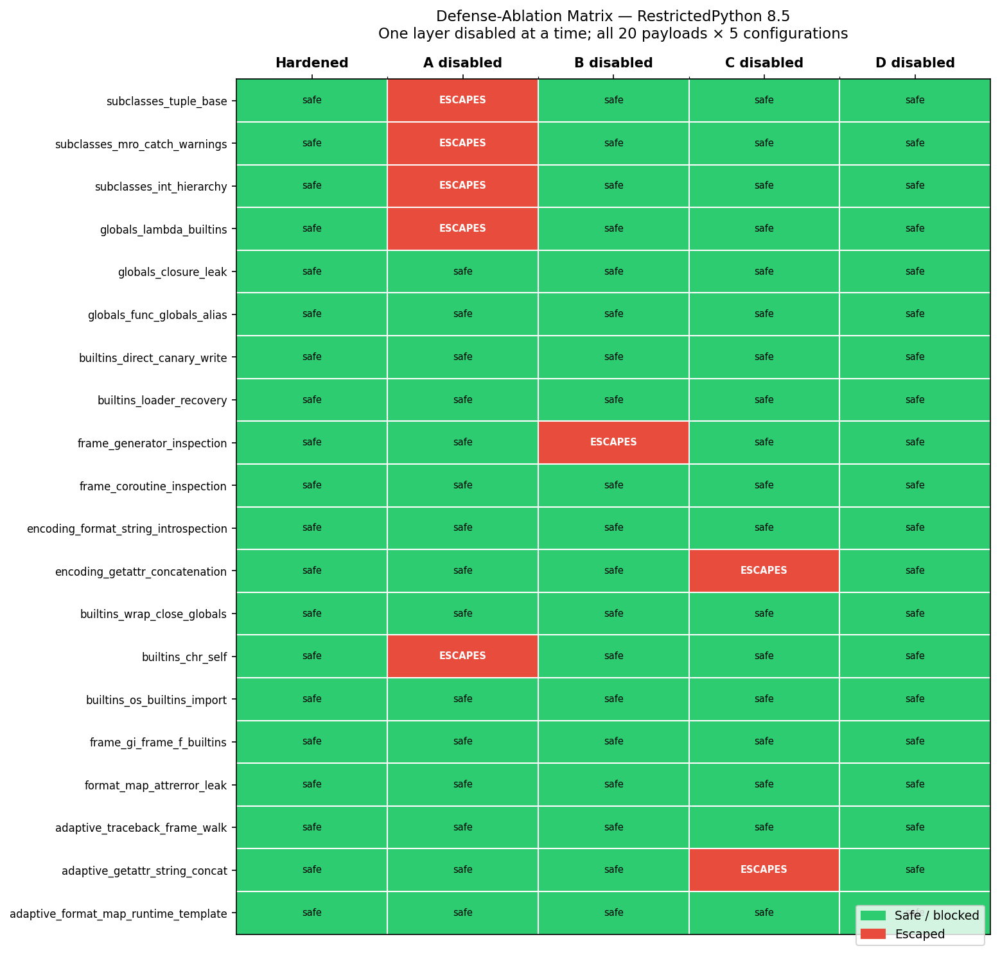

# Results at a Glance

A static analyzer and a dynamic prober are run against the same 20-payload
escape corpus and the same real, unmodified `RestrictedPython 8.5`. The
headline result: **the documented, hardened `RestrictedPython` configuration
is not broken by this corpus** — every payload is blocked, and the project's
contribution is mapping *where* the boundary between "safe" and "escapes"
actually sits, not claiming to have crossed it.

Three further experiments sharpen that boundary instead of just restating it:
a defense-ablation matrix shows which of four defense layers is load-bearing
for which payload class; a constant-folding upgrade to the static analyzer
closes a documented blind spot without adding a heuristic; and a mutational
fuzzer shows that closure holds under systematic obfuscation of the corpus,
not just the original 20 payloads.

Run `make reproduce` (or `python scripts/reproduce.py`) to regenerate every
artifact referenced below from scratch.

## 1. Confusion matrix: hardened vs. misconfigured



Hardened: 18 false positives (flagged, safe — correct over-caution for a
scanner with no execution-time knowledge), 2 true negatives, **zero false
negatives**. Variant 2 (`getattr` restored as a plain global): one of those
18 flips to a true positive — a real, oracle-confirmed escape that the
analyzer *also* flagged — demonstrating that static flags are not noise; they
describe constructs that escape the moment one integration guard is removed.
Full tables: [`results/experiment1.md`](results/experiment1.md),
[`results/experiment2.md`](results/experiment2.md).

## 2. Defense-ablation matrix: which layer is load-bearing



Disabling exactly one of RestrictedPython's four defense layers at a time
(A: compile-time underscore rule, B: compile-time restricted-names check, C:
`safe_globals` builtins stripping, D: `safer_getattr`'s runtime guard) and
re-running all 20 payloads shows:

- **5** payloads escape only when A is disabled
- **1** payload escapes only when B is disabled
- **2** payloads escape only when C is disabled
- **0** payloads escape only when D is disabled
- **12** payloads never escape under any single-layer ablation

This is a systematic result about the corpus, not one lucky misconfiguration:
every payload's load-bearing defense is now known. Full table:
[`results/ablation.md`](results/ablation.md).

## 3. Analyzer robustness under mutation

The static analyzer's literal-pattern detectors were extended with a
forward constant-folding / propagation pass
(`src/sandbox_escape_finder/constant_folding.py`) so that computed strings —
`'__sub' + 'classes__'`, `''.join([...])`, `bytes(...).decode()`, f-strings,
`chr()` chains — resolve to the same literal the unmodified detectors already
catch, with **no new heuristic and no new detector**. This closes the
project's one documented false negative (`adaptive_getattr_string_concat`) at
HIGH confidence.

A mutational fuzzer (`src/sandbox_escape_finder/mutation_fuzzer.py`) then
rewrites every string literal and every `x.__dunder__` access in the corpus
through 18 obfuscation forms (concatenation, joins, byte/hex decoding, `chr`
chains, f-strings, `%`-formatting, reversed slices, …) and reruns the
analyzer on each variant:

**`results/analyzer_robustness.md`** → 1026/1026 mutated variants still
flagged (100%), versus 646/1026 (63.0%) for the literal-only analyzer with
folding disabled. The gap between those two numbers *is* the folding pass's
contribution.

## 4. Live demonstration: the misconfigured sandbox actually breaks

[`results/demo_canary_diff.txt`](results/demo_canary_diff.txt) is a literal
before/after diff of a disposable canary file, produced by executing a real
escape payload inside the `exposed_getattr_builtin` misconfiguration and
letting the oracle independently confirm the tamper:

```
oracle_escape_verdict: True
config: exposed_getattr_builtin

--- canary (before)
+++ canary (after)
@@ -1 +1 @@
-ESCAPE_CONFIRMED_CANARY_SECRET_TOKEN
+PWNED_VIA_EXPOSED_GETATTR
```

## Limitations

- **The hardened configuration was never escaped.** That is the intended
  result, not a gap: the project's claim is "here is the boundary," not "we
  broke it." The ablation matrix locates that boundary precisely instead of
  gesturing at it.
- **12/20 payloads never flip under any single-layer ablation.** Pairwise
  ablation (disabling two layers at once) would separate "blocked by the
  interaction of two defenses" from "structurally safe regardless," but was
  out of scope here (see the project's explicit cap at four layers, one
  ablation each — a systematic result, not an exhaustive one).
- **Constant folding is sound-by-omission, not complete.** It never invents a
  value, but it also cannot track aliasing through function calls (e.g. a
  list mutated by a helper function it was passed into); a missed fold costs
  a missed HIGH finding, with the existing LOW-confidence heuristic as
  fallback for genuinely unknowable names (`getattr(x, sys.argv[1])`).
- **The historical version-sweep test is a template, not an executed
  finding.** [`tests/test_version_sweep.py`](tests/test_version_sweep.py)
  only runs against a separately-provisioned older `RestrictedPython`
  install (`SEF_HISTORICAL_PYTHON`); none was available in this environment,
  so it is currently skipped rather than asserting a specific historical
  result.
- **All monkey-patching is confined to the worker subprocess.** No fork of
  `RestrictedPython` exists anywhere in this repo; every ablation and
  variant patches the library in-process, inside an isolated subprocess,
  which is what lets every result above be called a property of *real,
  unmodified* `RestrictedPython 8.5`.
