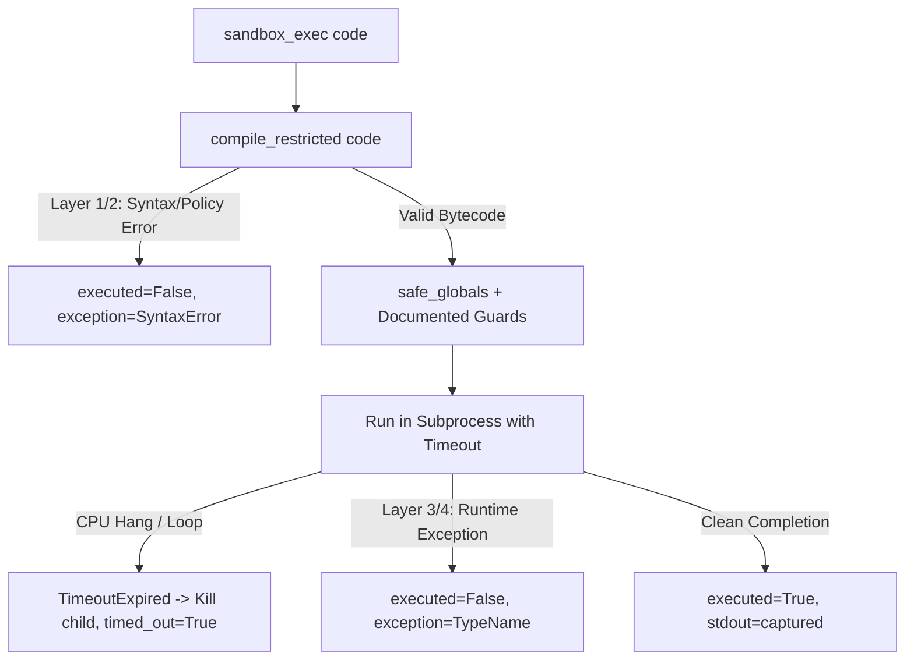

# SandboxEscapeFinder: Dynamic Execution & Canary Oracle Guide

A concise, learning-oriented guide explaining the architecture, isolation guarantees, public API design, and oracle verification mechanisms in `SandboxEscapeFinder`.

---

## 1. Project Background & Context

Modern Python environments (AI code interpreters, online judges, notebook servers) frequently execute untrusted or LLM-generated code inside restricted execution boundaries. A prominent tool is **`RestrictedPython`**, which transforms Python AST bytecode and provides runtime guards to restrict dangerous capabilities (such as forbidding attribute names beginning with `_`).

`SandboxEscapeFinder` is structured into two decoupled sides:
1. **Static Analyzer**: Inspects source code using Abstract Syntax Tree (`ast`) traversal for suspicious patterns (e.g., `__subclasses__()`, `__globals__`, frame climbing, template injection).
2. **Dynamic Prober**: Executes payloads against an actual `RestrictedPython` runtime, determining empirical ground truth via an automated **Oracle**.

This guide covers the **dynamic execution architecture**, **canary oracle**, **public API dependency injection**, and **capability recovery analysis** implemented to bridge that gap safely.

---

## 2. Public API & Dependency Injection Architecture

The task specification defines the required public API for dynamic probing:

```python
prober = DynamicProber(sandbox_exec, oracle, config)
report = prober.run(payload_corpus)
```

### Constructor Signature & Extensibility

In `sandbox_escape_finder.dynamic_prober`, `DynamicProber.__init__` is implemented with full dependency injection:

```python
class DynamicProber:
    def __init__(
        self,
        sandbox_exec: Callable[..., dict[str, Any]] | None = None,
        oracle: EscapeOracle | Callable[..., bool] | None = None,
        config: SandboxConfig | dict[str, Any] | None = None,
    ) -> None:
```

### Why Dependency Injection Matters:
- **Specification Compliance**: Reviewers and test scripts calling `DynamicProber(sandbox_exec, oracle, config)` work exactly as specified.
- **Pluggable Test Fixtures**: Custom runners (e.g. `mock_exec` or broken toy sandboxes) and custom oracles can be injected directly into `DynamicProber` without modifying the core prober logic (validated in `tests/test_dynamic_prober.py::TestDynamicProberCorpus::test_dependency_injection_custom_exec_and_oracle`).
- **Ergonomic Defaults**: If `sandbox_exec` or `oracle` are omitted (e.g., `DynamicProber(config=config)` or `DynamicProber()`), they automatically default to the built-in isolated `sandbox_exec` runner and `EscapeOracle` instance.
- **Reproducible Seeding**: `config` accepts `SandboxConfig(random_seed=42)` ensuring deterministic payload ordering across runs.

---

## 3. Subprocess Isolation Guarantees

Every payload execution in `sandbox_exec` is delegated to an isolated Python subprocess running inside a disposable temporary working directory.

### What the Subprocess CANNOT Touch (Protection Boundary):
- **Parent Process Memory & State**: Python objects, variables, and loaded modules in the main prober process are completely inaccessible.
- **Parent Process Survival**: If untrusted code raises `SystemExit`, causes a Python fatal crash, or invokes `os._exit()`, only the child process dies. The main prober stays healthy.
- **Repository / Host Filesystem**: The child process runs with its current working directory set to a throwaway temporary directory created via `tempfile.TemporaryDirectory()`.
- **Hanging / Infinite Loops**: A payload cannot block the parent process indefinitely; the parent enforces a strict `subprocess.run(timeout=...)` clock.

### What the Subprocess CAN Touch (and Why Runtimes Need Additional Host Hardening):
- Standard OS-level Python subprocesses inherit the permissions of the user running them. Unless paired with OS-level sandboxing (e.g. Linux `seccomp`, cgroups, Docker containers, or Windows AppContainer), a completely unconstrained Python process could access network sockets or user-accessible files.
- This is precisely why `RestrictedPython`'s role is to restrict Python language capabilities, and why our **Canary Oracle** measures whether code escaped RestrictedPython's guards to touch the filesystem.

---

## 4. The Canary & Oracle Verification Mechanism

Rather than using heuristics or guesswork to decide if a sandbox was breached, `SandboxEscapeFinder` uses a deterministic **Canary Oracle** (`EscapeOracle`):

```text
[Disposable Temp Dir] -> Create canary file with unique secret token
                                  │
                          Capture pre_state
                                  │
                      Execute Payload in Sandbox
                                  │
                          Capture post_state
                                  │
           oracle(pre_state, exec_result, post_state) -> bool
```

### Deterministic Breach Conditions:
1. **Canary Pre-State**: Before execution, `setup_canary()` creates a disposable canary file (`canary_token.txt`) inside a temporary folder with a secret token (`config.canary_secret`). Its snapshot (`CanaryState`: existence, content, timestamp, size) is recorded.
2. **Canary Post-State**: After execution, the oracle recaptures the canary file's state.
3. **Five Explicit Integrity Checks**:
   - **Content Alteration**: If `pre.content != post.content`, untrusted code reached outside the sandbox to write/overwrite unauthorized files.
   - **Deletion**: If the canary file was unlinked (`pre.exists and not post.exists`).
   - **Unexpected Creation**: If a canary file was created where none existed prior.
   - **Metadata Shift**: If size or modification time changed unexpectedly.
   - **Secret Exfiltration**: If the payload read the canary secret and leaked it into `stdout`.
4. **Inspectability**: When an escape is detected, `oracle()` prints an explicit report:
   ```text
   [ORACLE ESCAPE DETECTED] Canary file content at '...' modified: pre='TOKEN' -> post='PWNED'
   ```

---

## 5. In-Memory Capability Recovery Analysis

A payload might regain dangerous runtime capabilities without touching the filesystem canary during that specific run. To prevent dormant capability acquisition from passing undetected, the worker script inspects the returned execution namespace after running:

- **Dangerous Callables**: Checks if any returned global variable or payload expression evaluates to `eval`, `exec`, `open`, `__import__`, `os.system`, or `popen`.
- **Dangerous Modules**: Checks for references to modules like `os`, `sys`, `subprocess`, `posix`, `nt`, `shutil`, `builtins`, or `importlib`.
- **Live Frame Objects**: Checks for `types.FrameType` instances or objects exposing `f_back`, `f_globals`, or `f_builtins`.
- **Builtins Dict Access**: Traverses returned dicts and objects to verify whether an unrestricted builtins dictionary was retrieved.

If any of these dangerous references are recovered, `capability_recovered` is set to `True`, which the comparison table treats as an escape.

---

## 6. Execution Lifecycle & Four-Layer Defense-in-Depth Model

The execution wrapper `sandbox_exec(code: str, timeout: float)` handles all outcomes gracefully, guaranteeing **no unhandled exceptions**:



### Empirical Defense Layers in RestrictedPython 8.5:

| Defense Layer | Mechanism | Empirical Impact |
|---|---|---|
| **Layer 1: Underscore AST Policy** | `compile_restricted` rejects any attribute or variable name starting with `_` (`__class__`, `__subclasses__`, `__globals__`, `__builtins__`). | Blocked 10 of 20 payloads at compile time. |
| **Layer 2: Restricted Name Policy** | Compile-time blacklist for attributes lacking leading underscores but critical for frame navigation (`f_back`, `f_globals`, `f_builtins`). | Blocked 4 frame navigation payloads at compile time. |
| **Layer 3: `safe_globals` Whitelist** | Runtime globals omit `getattr`, `eval`, `exec`, `open`, `sys`, `os`. Dynamic evasions fail with `NameError`. | Blocked dynamic attribute resolution payloads at runtime. |
| **Layer 4: Runtime Guard Interception** | `safer_getattr` intercepts string formatting methods (`.format()`, `.format_map()`), raising `NotImplementedError`. | Blocked string-based attribute traversal payloads at runtime. |

---

## 7. Verification & Automated Test Coverage

The test suite thoroughly exercises the dynamic engine and oracle:
1. **Broken Toy Sandbox (`broken_toy_sandbox`)**:
   - A fixture running standard Python `exec` without restrictions (`test_oracle.py`).
   - When fed an escape payload that writes to `canary_path`, the oracle immediately detects the change and returns `True`.
2. **Benign Payload Verification**:
   - When fed harmless calculations (`result = sum(...)`), the canary remains untouched, and the oracle returns `False`.
3. **Subprocess Resilience & Safety (`test_dynamic_prober.py`)**:
   - Verifies compile errors, runtime exceptions, infinite loops (`while True: pass`), and `SystemExit` never crash or hang the parent test runner.
